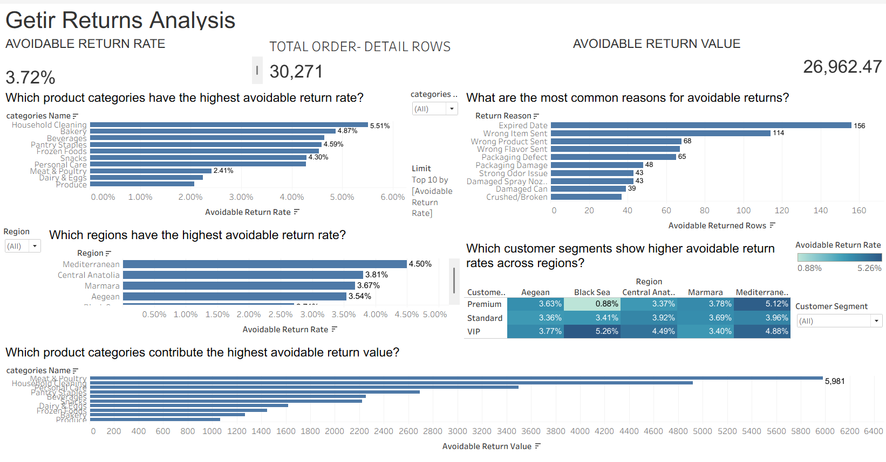

# Getir – Reducing Avoidable Returns

**Business Analyst Portfolio Project | NextLeap Graduation Project**

A Business Analysis project exploring avoidable product returns in Getir's quick-commerce operations using Microsoft Excel and Tableau.

The analysis examines return performance, identifies potentially avoidable returns, highlights patterns across product categories, regions and customer segments, and recommends operational areas for further investigation.

## Project Overview

| Detail | Description |
|---|---|
| Project | Getir – Reducing Avoidable Returns |
| Dataset | NextLeap-provided project dataset |
| Records analysed | 30,271 order-detail records |
| Unit of analysis | Individual product line within an order |
| Tools | Microsoft Excel, Tableau |
| Analysis | Return patterns, KPI analysis, customer research and business requirements |
| Deliverables | Final Report, Excel Analysis and Tableau Dashboard |

## Project Objectives

- Analyse overall product return performance.
- Measure avoidable return rates and associated product value.
- Identify patterns across product categories and regions.
- Compare customer segments.
- Identify the most frequently recorded avoidable return reasons.
- Recommend operational areas for further investigation.

## Key Findings

| Metric | Result |
|---|---:|
| Total order-detail records | 30,271 |
| Returned rows | 1,424 |
| Avoidable returned rows | 1,125 |
| Avoidable Return Rate | 3.72% |
| Avoidable Share of Returns | 79.00% |
| Estimated Avoidable Return Value | 26,962.47 |

### Important Insights

- **Product Category:** Household Cleaning recorded the highest avoidable return rate at 5.51%.
- **Regional Analysis:** Mediterranean recorded the highest regional avoidable return rate at 4.50%.
- **Return Reasons:** Expired Date was the most frequently recorded avoidable return reason, with 156 rows.
- **Estimated Value:** Meat & Poultry contributed the highest estimated avoidable return value of 5,980.51.

## Dashboard Preview

### Tableau – Overall Returns Overview

**Explore the interactive dashboard:**

[View Dashboard on Tableau Public](https://public.tableau.com/views/NL_Getir_Tableau/OverallReturnsOverview)

## Methodology

1. Reviewed and prepared the supplied order, product, customer and return data.
2. Examined data quality and established the unit of analysis.
3. Defined KPIs and calculated avoidable return metrics.
4. Performed exploratory analysis across product categories, regions and customer segments.
5. Conducted supplementary customer research and documented business requirements.
6. Developed Tableau visualisations and identified business recommendations.

## Business Recommendations

The analysis identified the following areas for further investigation:

- Review expiry-date checks, stock rotation and inventory controls.
- Investigate order-picking verification and item accuracy.
- Prioritise category-level quality reviews.
- Examine regional return patterns while considering record volumes.
- Review packaging and product-handling controls.
- Monitor customer complaints and resolution experiences.

## Project Report

[View the Complete Project Report (PDF)](./NL_Getir%20(1).pdf)

## Tools & Skills Demonstrated

- Microsoft Excel
- Data Preparation and Quality Checks
- KPI Calculation and Analysis
- Exploratory Data Analysis
- Business Requirements Documentation (BRD)
- Customer Research and Thematic Analysis
- Tableau Dashboard Development
- Data Visualisation
- Business Insights and Recommendations

## Data Disclaimer

This is an independent graduation portfolio project based on the dataset supplied for the NextLeap programme. It is not an analysis of Getir's internal company data, and the findings should not be interpreted as official Getir business results.

Avoidable returns are classified according to the project's defined return-reason rule. The estimated return value represents associated product value, not confirmed refunds, audited losses or net financial impact.

The analysis is descriptive and does not establish the operational root cause of individual returns.
